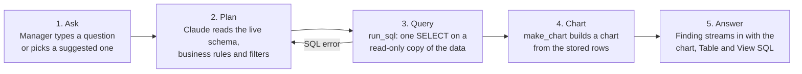
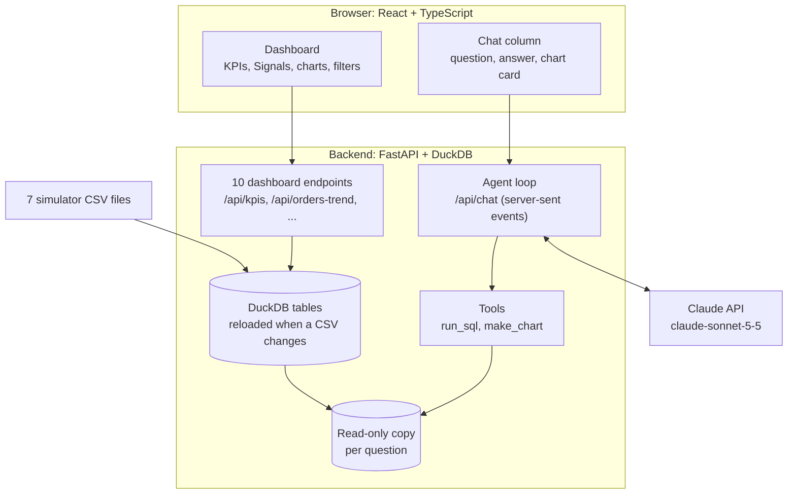

# The Modern Furniture Co. AI Analytics Agent

A proof of concept for **AI Analytics, Assessment 2**: a generative-AI analytics agent that lets managers at Modern Furniture Co. ask questions about their operational data in plain English and get back a short answer, a chart, a data table and the exact SQL behind every number. It sits beside a live dashboard built on the same data and the same definitions.

- **Slide deck:** [link to the deck]
- **Demo video:** [link to the screen recording]
- **Data:** the Advanced Furniture Manufacturing Simulator export in `DataA2-1/DataA2/` (7 CSV files, January 2025 to December 2026)

## Contents

1. [Project overview](#1-project-overview)
2. [Business problem analysis](#2-business-problem-analysis)
3. [Business requirements](#3-business-requirements)
4. [Conceptual design](#4-conceptual-design)
5. [Data integration plan](#5-data-integration-plan)
6. [Proof of concept](#6-proof-of-concept)
7. [Running the project](#7-running-the-project)
8. [Testing and feedback](#8-testing-and-feedback)
9. [Risks and ethics](#9-risks-and-ethics)
10. [Conclusions and recommendations](#10-conclusions-and-recommendations)
11. [Project structure](#11-project-structure)

---

## 1. Project overview

Modern Furniture Co. is a custom furniture manufacturer. Its simulator produces rich data on sales, finance, production, inventory and staff, but managers have no easy way to question it. They do not write SQL, cannot read raw CSV files, and wait on an analyst for every follow-up.

This project gives them an **analytics agent**: a chat built on Claude (Anthropic's language model) that turns a question such as *"Which product type is the most profitable?"* into read-only SQL, runs it on the company's data, and answers in a few plain sentences with a chart.

**Value proposition**

| Promise | How the prototype keeps it |
|---|---|
| **Ask** in plain English | No SQL, no fixed menu of reports: the agent writes its own query for any question the seven files can answer. |
| **Trust** every number | The model never types a figure itself. Numbers come from SQL results, charts are built from the stored rows of a query, and the SQL is one click away ("View SQL"). |
| **See** the answer in context | Each answer is a short finding plus a chart and a table, shown in a chat that docks beside a live dashboard using the same definitions. |

The dashboard alone shows the standing picture (KPIs, trends, rankings and plain-English "Signals" computed from the data). The agent answers what the dashboard does not already show.

---

## 2. Business problem analysis

> **Note:** the Case Study document referred to in the brief was not available for this project. The analysis below starts from the four challenges the brief names (demand forecasting, production efficiency, cost control, reputation management) and measures each one in the simulator data.

All figures are for January 2025 to December 2026 and were computed with SQL on the provided CSV files.

| Rank | Challenge | What the data shows | Business question the agent answers |
|---|---|---|---|
| 1 | **Production efficiency** | Joinery takes 29.8 of 74.6 labour hours per delivered order (40%), the largest stage in every quarter, including Q4 2026 (29.5 of 73.8 hours). | *"What was our biggest production bottleneck last quarter?"* |
| 2 | **Reputation: on-time delivery** | On-time delivery is normally near 100%, but fell to **18% in November 2025** (after 5 resignations from July to October 2025) and **24% in May 2026**. **9 of the 13 designers** on the roster have resigned. 61 delivered orders were late, each paying a 10% penalty. | *"Show me the impact of employee resignations on our on-time delivery rate."* |
| 3 | **Cost control** | Revenue beat costs by only **$214K (4.3%)** over two years ($4.98M against $4.76M). Late penalties cost **$60K**, about 28% of that margin. Daily wages and overheads are $3.17M of cost; material reorders $1.61M. | *"Which product type is the most profitable?"* |
| 4 | **Demand forecasting** | About 47 new quotes a month, peaking at 70 in October 2026. **54% to 62% of quotes are lost** (rejected by the customer) for every product; Sideboard, the most profitable product per order, is also the most often lost (62%). | *"How is demand trending, and which products lose the most quotes?"* |

**Prioritisation.** Production efficiency, on-time delivery and cost control come first because they are where money is lost today: a bottleneck stage, penalties on late orders, and a margin thin enough that one bad quarter erases it. Demand trends are supported, but forecasting itself is a recommendation (section 10), not part of this prototype.

---

## 3. Business requirements

### Users

Non-technical managers who run the business day to day: they want a trustworthy answer to an operating question without an analyst in the loop. They use a desktop browser at work and occasionally a phone.

### Functional requirements

| # | Requirement | What the agent does | How it is checked |
|---|---|---|---|
| FR1 | **Answer questions in plain English** | Understands the question, writes read-only SQL on the seven tables, and answers in 2 to 5 sentences that lead with the answer. Uses the dashboard's current date range and product filter as context. | The brief's three questions return figures that match the dashboard. |
| FR2 | **Show the evidence** | Draws a chart (line, bar, horizontal bar or donut) when the answer is a trend, comparison or ranking; offers the data table and the SQL. An invalid chart falls back to a table rather than a blank box. | Every figure traces to a stored query result. |
| FR3 | **Use one set of definitions** | LOST means a rejected quote (never produced). On-time % is of delivered orders. Quotes and win rate are dated by creation; everything about delivered orders by completion. Labour is costed at the average wage per role. | An automated test checks that the KPI cards and charts count the same orders. |
| FR4 | **Be honest about limits** | Says when the data cannot answer a question, when a result rests on few rows, and reports timing ("fell after"), never cause ("caused by"). | Prompt rules; reviewed in answer testing. |
| FR5 | **Stay safe by design** | Works on a read-only copy of the data per question: one SELECT per call, 10-second timeout, 1,000-row cap, no file or network access, at most 6 model steps per question. | 12 tool tests, including blocked writes and file reads. |
| FR6 | **Keep the standing picture visible** | A dashboard of KPIs, Signals and charts with a date-range filter (all time, last 12 or 6 months, each year in the data, custom) and a product filter. New months or years appear without code changes. | Verified with simulated 2027 data. |
| FR7 | **Keep useful answers** | Any chart the agent draws can be pinned to the dashboard as a dated snapshot, with its table and SQL. The manager can drag any panel to a new place and drag its edges to resize it, with the other panels reflowing around it; the arrow keys do the same from the keyboard. Pins, layout and the chat are remembered in the browser. | Checked in the browser with real mouse drags and key presses: pin, move, resize, reload, reset; `npm test` covers the row-filling rule. |

### Non-functional requirements

- **Trust:** no number is ever generated by the language model; all come from query results.
- **Accessibility:** WCAG 2.1 AA as a best effort: contrast, full keyboard use, screen-reader labels, reduced-motion support, colour never the only cue.
- **Responsiveness:** works from a 390px phone to a wide desktop; the chat narrows the page rather than covering it on a desktop.
- **Speed:** dashboard API requests return in about 6 to 14 ms; the chat streams its answer as it is written.
- **Freshness:** new or edited CSV files are picked up on the next request, with no restart.

### Inputs and outputs

- **Inputs:** all seven simulator CSV files (section 5), the user's question, and the filters on screen.
- **Outputs:** a written finding, key figures, a chart, a data table, and the SQL that produced them.

---

## 4. Conceptual design

### User interaction flow



1. **Ask.** The manager opens "Ask the data" (or presses Ctrl/Cmd + K) and types a question or picks one of the suggested questions. A context bar shows which date range and product the question will use.
2. **Plan.** Claude receives the question, recent chat history, the live table schema, business notes (definitions and data quirks) and the validated filters.
3. **Query.** Claude calls `run_sql`. The query runs on a sandboxed, read-only copy of the data. If it fails, the error goes back to Claude, which corrects the SQL and tries again.
4. **Chart.** Claude calls `make_chart` with the id of a stored result. The chart's rows are copied from that result, so a chart can never show a number the model typed.
5. **Answer.** The answer streams into the chat with its tool steps ("run_sql · orders_data, hr_roster"), the chart card, and **Table** and **View SQL** buttons. Screen readers hear the finished answer once.

### Architecture



### Interface

- **One page, no navigation.** A header with the title, the data's date range, the filters and the primary "Ask the data" button.
- **KPI strip:** revenue, on-time delivery, late orders, quote win rate, average order value, average lead time. Each figure has a plain-English sub-line ("397 of 458 delivered").
- **Signals:** a dark strip of four findings computed from the data (bottleneck, on-time, profit, margin), never typed by hand.
- **Charts:** orders created vs delivered, revenue vs cost, on-time delivery vs resignations (months under 50% ringed in red), and ranked bars for hours per stage, profit per order and accepted orders by product.
- **Chat column:** docks as a 440px column on a desktop, so the dashboard narrows instead of being covered; on a phone it becomes a full-screen dialog.
- **Pinned charts:** "Pin to dashboard" on any agent chart adds it to the top of the dashboard grid as a snapshot (it says so, and the filters do not change it), with Table and View SQL.
- **Move and resize, no edit mode:** drag a panel by its title (or the grip on its top edge) and drop it anywhere; the others slide out of the way. Drag its right edge, bottom edge or corner to resize it: widths snap to a third, two-thirds or the full row, and charts grow with the panel's height. The grip and the corner also work with the arrow keys. Rows never have holes: the last panel of an unfinished row widens to fill it. "Reset layout" appears once anything has changed.
- **States:** every panel has loading, error (with "Try again"), empty and updating states; a backend that cannot be reached says so.

### Design decisions

- **Answer first, evidence one click away**, so a busy manager reads one sentence and an analyst can still audit it.
- **One accent colour (Signal Blue) and one warning colour (Alarm Red)**: red appears only where something went wrong, and colour is always paired with text or a line style.
- **A flat, ledger-like look** (paper-white panels, hairline rules, Hanken Grotesk for reading and IBM Plex Mono for measured values) in deliberate contrast to gradient-heavy "AI dashboard" styling.

---

## 5. Data integration plan

### Sources

| CSV file | Rows | Used to answer | Processing |
|---|---:|---|---|
| `orders_data.csv` | 1,166 | Stage hours (bottleneck), on-time %, lateness and penalties, order value, profit per product, demand and lost quotes | Dates typed; empty dates become NULL; `LOST` = quote rejected by the customer (no production) |
| `financial_ledger.csv` | 2,508 | Revenue, cost and margin by month | `REVENUE` (deposits and final payments, penalties already deducted) vs `COST` (daily wages, daily overheads, material reorders); no product column |
| `hr_events_log.csv` | 215 | Resignations, hires and leave by month | Lined up with on-time % by completion month (timing, not cause) |
| `hr_roster.csv` | 24 | Wages by role; who resigned | Average wage per role × stage hours = estimated labour cost per order |
| `design_log.csv` | 490 | Design duration per order and designer workload | Joined to orders on `orderId`; designers joined to the roster on `employeeId` |
| `inventory_log.csv` | 600 | Material consumption and reorders | `"N/A"` order ids become NULL; `CONSUME` vs `REORDER` |
| `customers_data.csv` | 1,166 | (Not used: one order per customer) | Loaded and available to the agent |

### Pipeline

1. **Load.** `backend/db.py` reads every CSV in the data folder into an in-memory DuckDB table of the same name, with typed columns (`read_csv_auto`, treating empty strings and `N/A` as NULL).
2. **Keep fresh.** Before each API request the backend checks each file's modification time and reloads only the files that changed, so new months or years appear without a restart or code change.
3. **Define once.** `backend/metrics.py` holds one SQL query per dashboard panel, using the shared definitions in section 3 (FR3). The same definitions are written into the agent's system prompt, so the chat and the dashboard agree.
4. **Range.** The date range comes from the data itself; a trailing month with fewer than 7 days of data (the one-day stub on 1 January 2027) is excluded.
5. **Isolate the agent.** Each chat question gets its own copy of the tables in a separate DuckDB connection with external access disabled and configuration locked. The agent can read but never change the data, read files, or reach the network.

### Key derived metrics

| Metric | Definition |
|---|---|
| Revenue (dashboard) | Sum of ledger `REVENUE` in the range (cash, after late penalties) |
| On-time % | Delivered on time ÷ delivered, by completion date |
| Quote win rate | Quotes with status other than `LOST` ÷ all quotes, by creation date |
| Average order value | `quotePrice × (1 − penaltyPct)` for delivered orders |
| Lead time | `completionDate − creationDate` for delivered orders |
| Estimated profit per order | Net order value − material cost − design hours × average designer wage − (milling + joinery + finishing hours) × average maker wage |


---

## 6. Proof of concept

### Technology

| Layer | Technology | Why |
|---|---|---|
| Language model | **Claude** via the Anthropic API (`claude-sonnet-5-5` by default), Python SDK | Strong at writing SQL and following strict rules; native tool use and streaming |
| Agent pattern | Manual tool-use loop with two tools, `run_sql` and `make_chart` | Full control over limits, safety and how results reach the screen |
| Backend | **Python, FastAPI** | Small JSON API plus a server-sent-events stream for the chat |
| Data engine | **DuckDB** (in-memory) | Runs SQL directly on the CSV files, fast aggregation, no database server to run |
| Frontend | **React 19, TypeScript, Vite** | Typed components, fast development server |
| Styling | **Tailwind CSS 4** with design tokens | One set of colours, sizes and radii shared by every component |
| Charts | **Apache ECharts** (modular build) | The same chart engine draws the dashboard and the agent's charts |
| Data fetching | **TanStack Query** | Caching, retries, and keeping previous numbers visible while a filter loads |

### How the agent works

- **System prompt** (`backend/agent.py`): role and working rules (query first, every number from a query, two to five sentences, timing not cause, plain text only), business notes (definitions and data quirks), the **live table schema** read from the database, and the validated dashboard filters.
- **`run_sql`** (`backend/tools.py`): accepts exactly one SELECT statement; stops it after 10 seconds; keeps up to 1,000 rows as a stored result with an id; shows the model the first 25 rows.
- **`make_chart`**: takes a stored result id, the chart type (`line`, `bar`, `hbar`, `donut`), the x and y columns, a title and a value format (`number`, `currency`, `percent`); copies the rows from the stored result (at most 200).
- **Loop:** up to 6 model calls per question; tool results go back to Claude in one message; refusals and cut-off answers are never run as tools; API, connection and rate-limit errors become readable messages in the chat.
- **Streaming:** the chat shows what the agent is doing through the silent stretches ("Writing a query", "Reading the results", "Drawing a chart") until the answer text starts, and each chart arrives after its answer text, so the answer reads top to bottom.
- **Model settings:** `max_tokens` 16,000, `effort` medium, the last 12 chat messages sent as history. The model can be changed with `ANTHROPIC_MODEL`.
- **Demo mode:** when no API key is set, the chat answers a few built-in questions from the same data, so the interface can be shown without a key.
- **Charts:** donuts put the largest share in the centre and label the other slices; bars print their values; a ranking shows its leader in Signal Blue, and anything named as a problem (late, lost, rejected, resigned) in Alarm Red.
- **Memory:** pinned charts, the panel layout and the chat are kept in the browser's local storage, so a reload loses nothing. There is deliberately no server database: one manager per browser needs none (see section 10 for when one would be needed).

### The brief's three questions

| Question | What the data says (computed with SQL) |
|---|---|
| "What was our biggest production bottleneck last quarter?" | Joinery: 29.5 of 73.8 labour hours per order in Q4 2026 (40%). |
| "Show me the impact of employee resignations on our on-time delivery rate." | On-time delivery fell to 18% in November 2025, after 5 resignations in the previous 4 months, and to 24% in May 2026. This is a timing relationship, not proof of cause. |
| "Which product type is the most profitable?" | Sideboard: about $5,600 estimated profit per delivered order; Media Console is lowest at about $3,163. |

### API

| Method and path | Returns |
|---|---|
| `GET /api/meta` | Date range in the data, product list, whether the last month is partial |
| `GET /api/kpis` | The six KPI figures |
| `GET /api/orders-trend` | Orders created and delivered per month |
| `GET /api/revenue-cost` | Ledger revenue and cost per month |
| `GET /api/ontime-vs-resignations` | On-time % and resignations per month |
| `GET /api/stage-hours` | Average hours per production stage |
| `GET /api/profit-by-product` | Estimated profit per delivered order, by product |
| `GET /api/product-mix` | Accepted orders by product |
| `GET /api/delivery-status` | Delivered orders on time vs late |
| `GET /api/weekday` | Orders created by weekday |
| `GET /api/chat/status` | Whether an API key is set, and the model |
| `POST /api/chat` | Streams the agent's answer as server-sent events: `status` (what it is doing now), `step`, `text`, `chart` (sent after the text) and `error` |

Dashboard endpoints accept `from`, `to` (ISO dates) and `productType`; without them they cover the full range in the data.

---

## 7. Running the project

### Requirements

- Python (built with 3.14) and Node.js (built with 26)
- An Anthropic API key for the live agent (optional: without one, the chat runs in demo mode)

### Backend

From `backend/`:

```sh
python -m venv .venv
.venv/bin/pip install -r requirements.txt
cp .env.example .env                   # then set ANTHROPIC_API_KEY in .env
.venv/bin/uvicorn main:app --reload    # http://localhost:8000
```

On Windows, use `python -m venv .venv`, then `.venv\Scripts\pip install -r requirements.txt`, `copy .env.example .env` and `.venv\Scripts\uvicorn main:app --reload`. If `python` is not found on macOS or Linux, use `python3`.

### Frontend

From `frontend/`, in a second terminal:

```sh
npm install
npm run dev                            # http://localhost:5173 (forwards /api to the backend)
```

Open http://localhost:5173 and select **Ask the data**.

### Configuration

| Variable (in `backend/.env`) | Purpose | Default |
|---|---|---|
| `ANTHROPIC_API_KEY` | Key for the Claude API. Without it, the chat runs in demo mode. | none |
| `ANTHROPIC_MODEL` | Which Claude model answers questions | `claude-sonnet-5-5` |
| `DATA_DIR` | Folder holding the simulator CSV files | `DataA2-1/DataA2` |

`.env` is ignored by git; never commit the key.

---

## 8. Testing and feedback

### Automated tests

78 backend tests (pytest), all passing. Run them from `backend/` with `.venv/bin/python -m pytest`.

| File | What it checks |
|---|---|
| `tests/test_agent_loop.py` | The full agent loop against a fake Claude server: query, chart and answer; tool errors sent back and corrected; parallel tool calls; the 6-step limit; refusals and cut-off answers never run as tools; API, connection and missing-key errors become messages; history cleaning; progress reported through the silent stretches; charts sent after the answer text, and kept when a later step fails |
| `tests/test_agent_parts.py` | The system prompt contains the live schema and notes; only valid context reaches the prompt; untrusted context never does; tool execution and readable errors |
| `tests/test_tools.py` | Tables load with the dashboard's types; only one SELECT is allowed; files outside cannot be read; bad SQL gives a readable error; row cap and preview; slow queries time out; chart specs are built only from stored rows; chart limits |
| `tests/test_chat_route.py` | Key status; a clear error without a key; a whole answer streams end to end; crashes become error events; malformed requests are rejected |
| `tests/test_metrics.py` | The KPI cards and the charts count the same delivered orders, across date ranges and product filters |

`npm run build` in `frontend/` type-checks the code and fails if the chart colours drift from the design tokens. `npm test` in `frontend/` runs the tests for the dashboard's row-filling rule (Node's built-in test runner, no extra packages).

### Interface and accessibility testing

- Rendered and checked in a headless browser at **390px (phone), 820px (tablet), 1100px with the chat docked, and 1440px (desktop)**, including loading, empty, error and offline states.
- Keyboard paths verified: focus moves into the chat when it opens and returns to the button that opened it, at every width; Esc closes the chat.
- Every text colour meets WCAG AA contrast (muted text 5.4:1 or better; control borders at least 3:1).
- Seven rounds of design and accessibility audits raised the score from **13/20 to 20/20**. Fixes included a mismatch where the KPI cards and the on-time chart dated orders differently, the smallest text being too small for a video recording, and focus being lost when the chat closed on phones.
- The expected answers to the brief's three questions were computed with hand-written SQL (section 6), so the live agent's answers can be checked against them.

### Live testing and feedback

- **Live agent with an API key:** 16 questions with answers computed independently in SQL beforehand: the brief's three, three follow-ups, and ten covering inventory, staff, designers, the ledger, ties, arithmetic and two deliberate traps (a customer satisfaction score the data does not hold; ledger revenue by product, which the ledger cannot split). **Every figure in every answer was correct**, and both traps were declined with the right reason instead of an invented number. Testing found and fixed: one misread column (the order stage read from `currentStage`, which is mostly empty, instead of `status`); false "I didn't run a query" apologies, caused by earlier answers' queries not being replayed in the history; a chart drawn for context nobody asked for; two series on very different scales sharing one axis; Markdown asterisks shown literally; a "lost quotes" chart that coloured the worst product blue; and a silent pause, with charts arriving before the text.
- **Peer feedback:** [2 to 3 classmates tried the agent; summarise what worked and what confused them]
- **Changes made from feedback:** [list]

---

## 9. Risks and ethics

| Risk | How the prototype handles it | Still to do |
|---|---|---|
| **Invented or wrong numbers** | Figures only come from query results; charts are built from stored rows; the SQL is always one click away. | A language model can still write a wrong query: keep an evaluation set (section 10). |
| **Claiming cause from timing** | The agent is instructed to report what happened before or alongside, never that one thing caused another. | Help managers read timing as a lead to investigate, not proof. |
| **Prompt injection in data** | Data values are treated as data, never instructions; queries run on a read-only copy with no file or network access. | Review if free-text fields such as `inquiryText` grow. |
| **Privacy of customers and staff wages** | The raw files stay on the server; only the question, the schema and query results reach the Claude API. | A data-processing agreement, and masking names in query results, before using real data. |
| **Over-reliance and open access** | Definitions are stated with answers; limits and small samples are called out. There is no login yet. | Authentication and role-based access before rollout. |
| **Cost and availability** | Each question is capped at 6 model calls; errors are shown plainly; the dashboard works without the API. | Monitor token use per question. |

---

## 10. Conclusions and recommendations

### What the project achieved

- A working agent that answers the brief's three questions, and open-ended follow-ups, with every figure traceable to SQL.
- One set of definitions shared by the dashboard and the chat, enforced by an automated test.
- A dashboard that adapts to new data on its own: new months and years appear without code changes.
- A safe design: the model can read the data but never change it, never type its own numbers, and never reach files or the network.

### Limitations

- The data is simulated, and the Case Study document was not available, so the problem analysis rests on the brief and the data.
- Labour cost uses the average wage per role, not each employee's actual time.
- The financial ledger has no product column, so profit by product is estimated per order, not reconciled to the ledger.
- There is no forecasting model; demand questions describe the past.
- The live agent has not yet been tested at scale or with many users, and there is no login.

### Recommendations

1. **Forecast demand.** Add a seasonal forecast of monthly quotes so joinery capacity can be planned before peaks like October 2026.
2. **Warn early on staff and delivery risk.** Alert when designers resign or on-time delivery starts to dip; 9 of 13 designers have left, and on-time collapsed twice after resignation waves.
3. **Cost orders accurately.** Record actual hours per employee so profit per product uses real wages, not role averages.
4. **Measure answer quality.** Keep a test set of about 30 questions with known SQL answers and track the agent's accuracy on every change.
5. **Make it production-ready.** Add login and role-based access and deploy it. Move pins, layouts and chat history from the browser into a server database (SQLite for one server, PostgreSQL once several people or servers share it), let pinned charts re-run their SQL so they follow new data, and let managers upload new CSV files for the agent to analyse.

---

## 11. Project structure

```
data-analytics/
├── DataA2-1/DataA2/          the simulator's 7 CSV files
├── backend/
│   ├── main.py               FastAPI app: dashboard endpoints and the chat stream
│   ├── db.py                 loads the CSVs into DuckDB and reloads changed files
│   ├── metrics.py            one SQL query per dashboard panel, shared definitions
│   ├── agent.py              system prompt and the Claude tool-use loop
│   ├── tools.py              run_sql and make_chart, the read-only sandbox
│   ├── tests/                78 pytest tests
│   ├── requirements.txt
│   └── .env.example
├── frontend/
│   ├── src/App.tsx           page layout
│   ├── src/components/       KPI strip, Signals, chart panels, filters, states
│   ├── src/components/chat/  chat column, messages, chart card, data table
│   ├── src/lib/dashboard.tsx panel order, widths and pins (saved in the browser)
│   ├── src/lib/layout.ts     built-in panels and the row-filling rule
│   ├── scripts/layout.test.ts    npm test: the row-filling rule
│   ├── src/lib/              API client, filters, formatting, chart options, chat state
│   ├── scripts/check-theme.mjs   build check: chart colours match the design tokens
│   └── index.html
└── AI Analytics A2.pdf       the assessment brief
```

